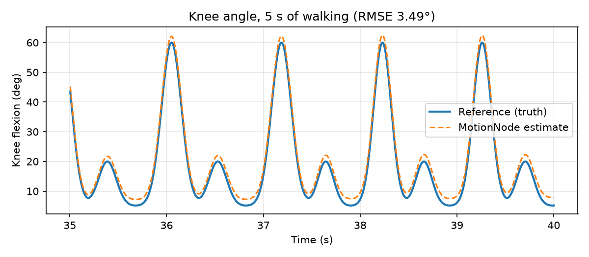
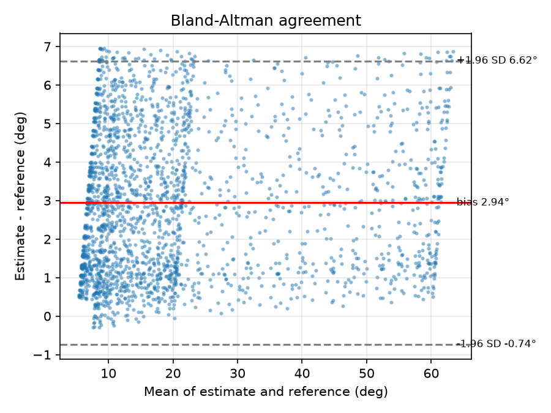
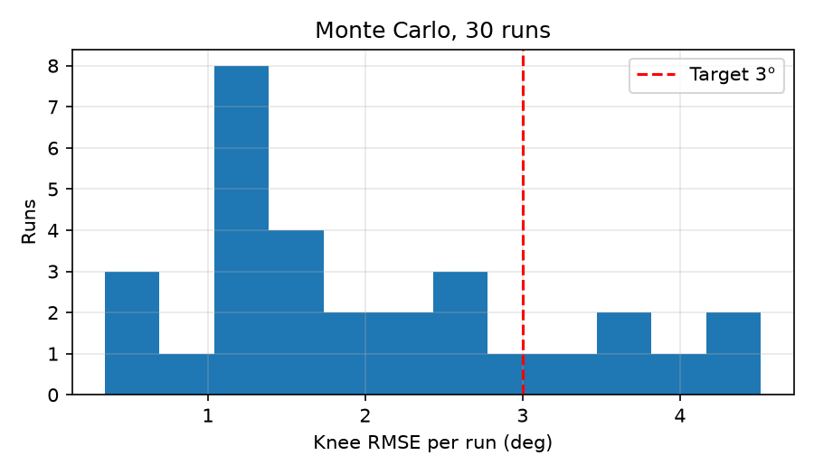
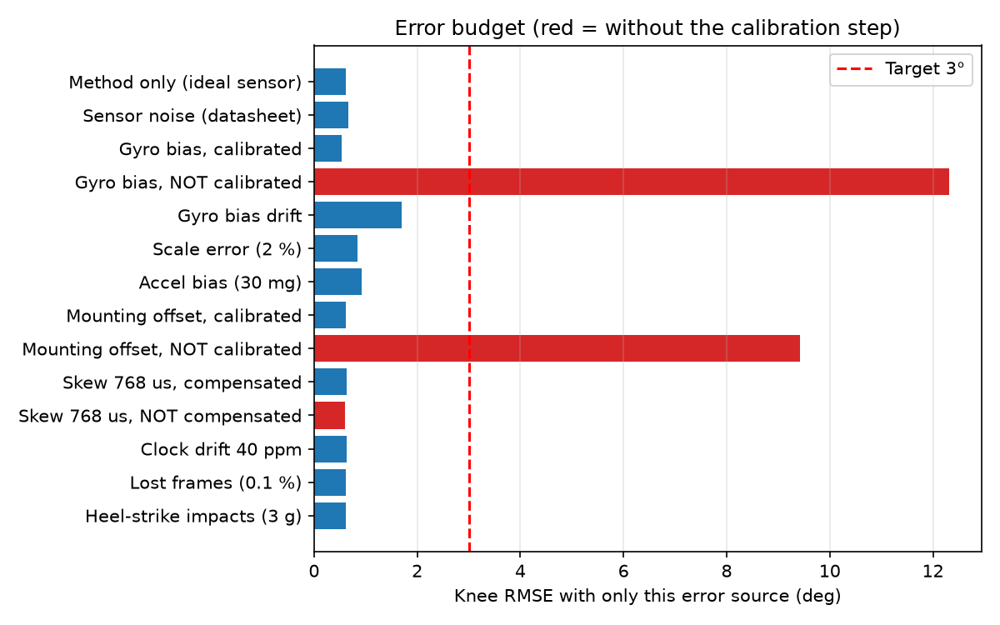
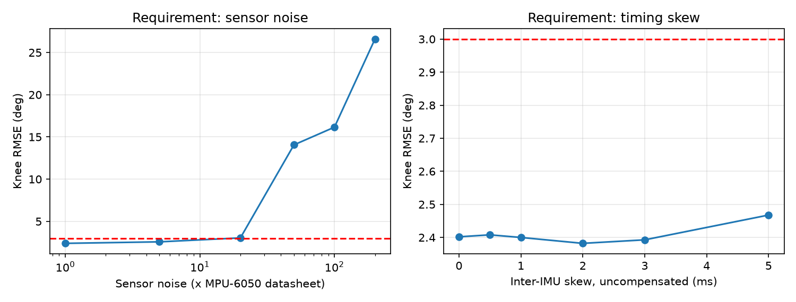

# MotionNode Lab report

Synthetic validation: the reference is the known true knee angle of a simulated session (stand 4 s, rigid leg swing 5 s, walk 60 s). On hardware the reference would be optical motion capture or an encoder hinge rig. All error sources are listed in lab/config.py.

## Result

**Knee flexion error: +0.79° ± 4.35° (k=2, ~95 %)**, RMSE mean 2.02°, 95th percentile 4.11°, worst 4.51° over 30 Monte Carlo runs; 80 % of runs meet the 3° target.

| Check | Result |
| --- | --- |
| sample rate within ±1 % | PASS |
| jitter < 100 µs | PASS |
| skew < 1000 µs | PASS |
| lost frames detected (seq gaps = injected) | PASS |
| knee RMSE < 3.0° (mean of 30 runs) | PASS |
| knee RMSE < 3.0° (95th percentile) | FAIL |

## Data integrity and timing (session 1)

| Metric | Value |
| --- | --- |
| Frames | 14985 |
| Lost frames (sequence gaps) | 15 |
| Sample rate | 200.00 Hz |
| Jitter (RMS) | 28.7 µs |
| Inter-IMU read skew | 768 µs |
| Clock drift vs reference (estimated) | 34.3 ppm (injected 40) |
| Time offset vs reference | -1.89 ms (includes on-chip filter delay) |

## Calibration: estimated vs injected

| Quantity | Estimated | Injected |
| --- | --- | --- |
| Thigh gyro bias | 0.243 °/s | 0.253 °/s |
| Shank gyro bias | 0.766 °/s | 0.775 °/s |
| Thigh mounting offset | 4.35° | 6.00° |
| Shank mounting offset | -4.37° | -4.00° |
| Inter-IMU sample skew | 770 µs | 768 µs |

Mounting-offset error comes from accelerometer bias (30 mg ≈ 1.7°): static calibration is limited by the accelerometer it relies on.

## Sensor fusion comparison (mean knee RMSE, 4 sessions)

| Method | RMSE |
| --- | --- |
| accel | 39.06° |
| gyro | 2.59° |
| complementary | 7.17° |
| kalman | 1.60° |

Accelerometer tilt alone is corrupted by segment acceleration during gait; a fixed-gain complementary filter lets that corruption in; gyro integration drifts with bias; the gated Kalman filter trusts gravity only when the segment is quiet and tracks the residual bias.

## Error budget (one source at a time)

| Source | Knee RMSE |
| --- | --- |
| Method only (ideal sensor) | 0.61° |
| Sensor noise (datasheet) | 0.67° |
| Gyro bias, calibrated | 0.54° |
| Gyro bias, NOT calibrated | 12.32° |
| Gyro bias drift | 1.70° |
| Scale error (2 %) | 0.84° |
| Accel bias (30 mg) | 0.92° |
| Mounting offset, calibrated | 0.61° |
| Mounting offset, NOT calibrated | 9.42° |
| Skew 768 us, compensated | 0.63° |
| Skew 768 us, NOT compensated | 0.59° |
| Clock drift 40 ppm | 0.63° |
| Lost frames (0.1 %) | 0.61° |
| Heel-strike impacts (3 g) | 0.61° |

## Requirements derived

| Sensor noise (× datasheet) | Knee RMSE |
| --- | --- |
| 1 | 2.40° |
| 5 | 2.58° |
| 20 | 3.04° |
| 50 | 14.06° |
| 100 | 16.16° |
| 200 | 26.59° |

| Uncompensated skew | Knee RMSE |
| --- | --- |
| 0.0 ms | 2.40° |
| 0.5 ms | 2.41° |
| 1.0 ms | 2.40° |
| 2.0 ms | 2.38° |
| 3.0 ms | 2.39° |
| 5.0 ms | 2.47° |

## Range check (±8 g)

| Scenario | Peak shank specific force | Time saturated at the ADC (60 s) |
| --- | --- | --- |
| walking 3 g | 4.3 g | 0.0 ms |
| running 12 g | 12.8 g | 495.0 ms |

## Plots

## Limitations

- Sagittal-plane (2-D) leg model; real gait is 3-D with soft-tissue motion.
- Sensor errors are datasheet typicals plus stated assumptions, not measured units.
- Zero-jitter Wokwi timing is replaced here by an assumed 20 µs; real values need hardware.
- The reference is simulated truth; hardware validation needs mocap or an encoder rig.
